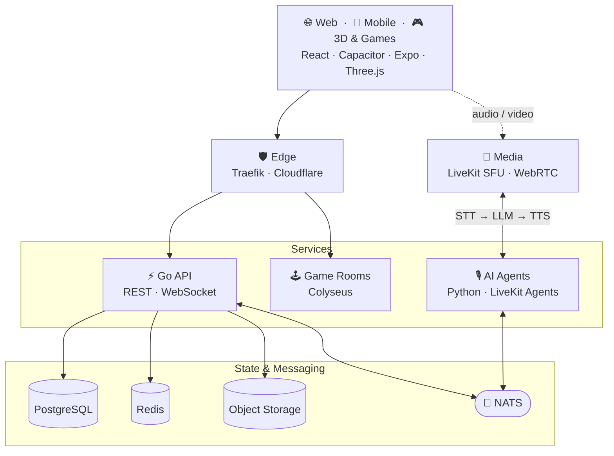

<a href="https://github.com/eyupduran">
  <picture>
    <source media="(prefers-color-scheme: dark)" srcset="./assets/header-dark.svg">
    <source media="(prefers-color-scheme: light)" srcset="./assets/header-light.svg">
    
  </picture>
</a>

<p align="center">
  <a href="https://www.linkedin.com/in/ey%C3%BCp-duran-103102204"></a>
  <a href="mailto:eyupduran19@gmail.com"></a>
  <a href="https://algoritimblog.netlify.app/"></a>
  
</p>

<br>

```go
package main

// I design and ship products end to end — from the Go service behind them
// to the app in your pocket, and lately, the AI voice that talks back.
type Engineer struct {
	Name     string
	Role     string
	Backend  []string
	Frontend []string
	Mobile   []string
	AI       []string
	Infra    []string
	Motto    string
}

var me = Engineer{
	Name:     "Eyüp Duran",
	Role:     "Full-Stack Software Engineer",
	Backend:  []string{"Go", "Python / FastAPI", "C# / .NET", "Node.js"},
	Frontend: []string{"React", "TypeScript", "Vite", "Three.js"},
	Mobile:   []string{"Capacitor", "React Native / Expo"},
	AI:       []string{"Realtime voice agents", "STT → LLM → TTS", "LLM tooling"},
	Infra:    []string{"Docker", "Kubernetes (k3s)", "Traefik", "Cloudflare"},
	Motto:    "Make it work, make it fast, make it feel alive.",
}
```

## ⟢ What I build

<table>
<tr>
<td width="50%" valign="top">

#### 🎙️ Realtime Voice AI
Low-latency conversational agents over WebRTC — streaming **STT → LLM → TTS** pipelines, voice activity detection, interruption handling and pluggable model providers.

<sub>`LiveKit` · `LiveKit Agents` · `Silero VAD` · `OpenAI` · `Gemini Live` · `Soniox` · `WebRTC`</sub>

</td>
<td width="50%" valign="top">

#### ⚡ Event-Driven Go Backends
REST + WebSocket services built for concurrency: message-bus fan-out, distributed locks, role-based access control, scheduled jobs and structured logging.

<sub>`Go` · `chi` · `WebSocket` · `NATS` · `Redis` · `Casbin` · `JWT` · `zerolog`</sub>

</td>
</tr>
<tr>
<td width="50%" valign="top">

#### 📱 One Codebase, Every Screen
A single React + TypeScript codebase shipped to **web, iOS and Android** — with push notifications, social login, in-app purchases and native device APIs.

<sub>`React` · `Vite` · `Capacitor` · `React Native` · `Expo` · `Redux Toolkit` · `Zustand` · `i18next`</sub>

</td>
<td width="50%" valign="top">

#### 🎮 Multiplayer, 3D & Games
Authoritative realtime game rooms, browser games on a shared monorepo engine, and 3D scenes that run smoothly on mobile.

<sub>`Colyseus` · `Phaser` · `Babylon.js` · `Three.js` · `React Three Fiber` · `Howler` · `Turborepo`</sub>

</td>
</tr>
<tr>
<td width="50%" valign="top">

#### 🎬 Code-Driven Video & Animation
Animations written as code and rendered frame-by-frame in headless Chromium to MP4 — plus glTF optimization pipelines and motion-heavy web experiences.

<sub>`Three.js` · `Puppeteer` · `Playwright` · `FFmpeg` · `glTF-Transform` · `GSAP` · `Lottie`</sub>

</td>
<td width="50%" valign="top">

#### 🛡️ Self-Hosted Infrastructure
Containerized stacks from laptop to cluster: reverse proxies, TLS, observability, malware scanning, backups and auto-healing services.

<sub>`Docker` · `k3s` · `Traefik` · `Nginx` · `Cloudflare` · `AWS S3` · `OpenObserve` · `ClamAV`</sub>

</td>
</tr>
</table>

## ⟢ Toolbox

<table>
<tr><td><b>Languages</b></td><td>

</td></tr>
<tr><td><b>Frontend</b></td><td>

</td></tr>
<tr><td><b>Backend &amp; Data</b></td><td>

</td></tr>
<tr><td><b>Infra &amp; Tooling</b></td><td>

</td></tr>
<tr><td><b>Realtime &amp; More</b></td><td>


</td></tr>
</table>

## ⟢ How I like to wire things



## ⟢ Open-source side projects

| Project | What it is | Built with |
| :-- | :-- | :-- |
| [**memoro**](https://github.com/eyupduran/memoro) | Vocabulary app that turns daily words into lock-screen wallpapers for passive learning | `React Native` `Expo` `SQLite` `Supabase` |
| [**Voxtory**](https://github.com/eyupduran/Voxtory) | Fully offline AI content & video studio — local TTS, transcription and transitions | `JavaScript` `Piper TTS` `Whisper` `FFmpeg` |
| [**claudelauncher**](https://github.com/eyupduran/claudelauncher) | Open any project & Claude Code session on your PC from your phone via Telegram | `Node.js` `Telegram Bot API` `VS Code` |
| [**animasyon-lab**](https://github.com/eyupduran/animasyon-lab) · [live](https://eyupduran.github.io/animasyon-lab/) | Browser-based 3D educational animations, rendered frame-by-frame to MP4 | `Three.js` `Puppeteer` `glTF` `GitHub Pages` |
| [**HadisAtlas**](https://github.com/eyupduran/HadisAtlas) | Multilingual reading, saving & sharing app | `React Native` `Expo` `TypeScript` |
| [**Vakitname**](https://github.com/eyupduran/Vakitname-expo) | Prayer-times app powered by a public REST API | `React Native` `Expo` `TypeScript` |

<p align="center">
  <sub>Currently exploring: lower-latency voice pipelines · on-device AI · AI-assisted developer tooling</sub>
</p>

<picture>
  <source media="(prefers-color-scheme: dark)" srcset="./assets/footer-dark.svg">
  <source media="(prefers-color-scheme: light)" srcset="./assets/footer-light.svg">
  
</picture>
